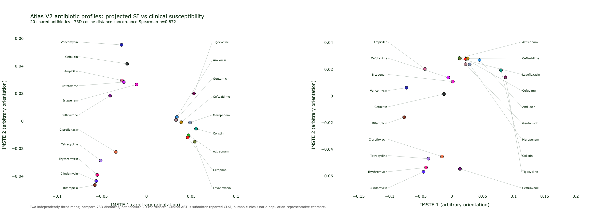
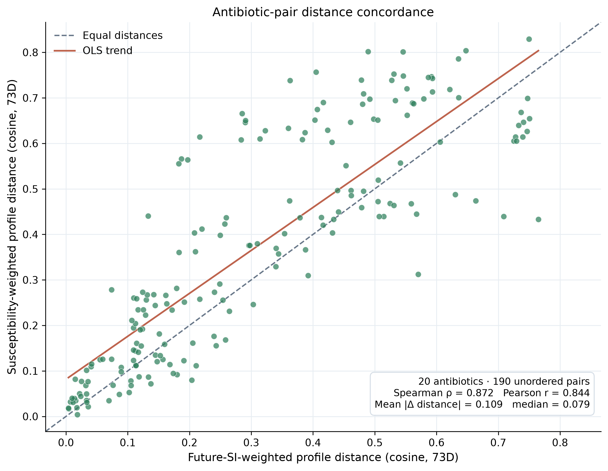
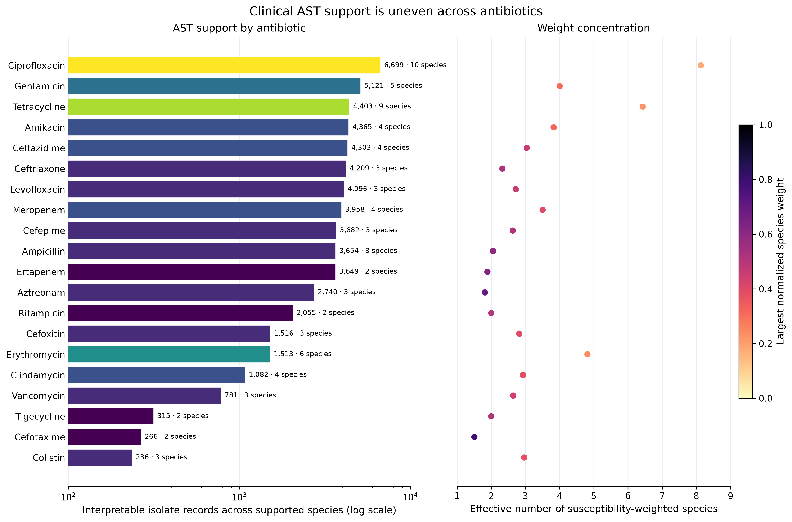

# Scientific-interest weighting recovers clinical susceptibility-associated structure in Atlas antibiotic profiles

**Chapter draft · quantitative readout from the exploratory notebook run on 17 November 2026**

## Summary

Can scientific-interest (SI) scores, derived from screened antimicrobial-resistance literature, produce antibiotic-level bacterial profiles whose similarity structure resembles profiles weighted by clinical susceptibility observations? In an exploratory matched comparison, the answer is yes: pairwise cosine distances between future-SI-weighted Atlas profiles and susceptibility-weighted Atlas profiles were strongly concordant across 20 antibiotics. Spearman rank correlation was **ρ = 0.872** and Pearson correlation was **r = 0.844** across the 190 unique antibiotic pairs. The association remained high when any one antibiotic was excluded in turn (leave-one-antibiotic-out Spearman ρ = 0.859–0.909).

The result supports SI as a useful **literature-derived weighting signal for organizing bacterial feature profiles**. It does not establish SI as a clinical susceptibility predictor, demonstrate agreement between individual isolate outcomes and SI, or show that SI and susceptibility are interchangeable. The comparator is a selected set of submitter-reported clinical AST observations, the eligible drugs and bacterial species are limited, support is uneven, and the AMR screening provenance is provisional and uncalibrated. We therefore treat this as a promising exploratory concordance result that motivates independent validation.

## 1. Rationale and question

AMR publication counts contain at least two components: general attention to a pathogen and an antibiotic, and attention specifically directed at resistance for that pathogen–antibiotic pair. The project’s SI measure is intended to capture the pair-specific component after adjusting the observed AMR literature count against a pooled background-attention model. We asked whether weighting bacterial evidence profiles by projected SI yields an antibiotic similarity structure that is consistent with one built from observed clinical susceptibility fractions.

The comparison is deliberately conducted in the Atlas feature space. Each antibiotic is represented by a weighted average of bacterial feature vectors, and the distance between two antibiotics is the cosine distance between these average vectors. The estimand is therefore the **cross-antibiotic concordance of two profile-distance matrices**. It is not a regression of a drug’s SI score on its susceptibility rate and is not an isolate-level classification analysis.

## 2. Data and cohort construction

### 2.1 Scientific-interest forecasts

The notebook used successful forecasts at the **2025 reference year and 2030 horizon**. Its AMR input contained 19,909 screened pair-year rows from 2000–2026. At this horizon, 171 successful forecast pairs covered 22 bacterial species and 53 antibiotics. Thirteen combination-product labels were excluded from the literature-footprint analysis, and combination labels were also excluded from forecast weighting where identified by the notebook.

The AMR screen provenance records a probability threshold of 0.75, a target precision of 0.90, no measured holdout precision, and status `provisional_uncalibrated`. These forecasts are consequently exploratory. A high association in this analysis cannot repair or substitute for calibration of the underlying screen.

### 2.2 Clinical AST observations

The notebook reused a locally saved filtered extract from the NCBI Pathogen Detection Antibiotic Susceptibility Test (AST) Browser. It retained records meeting all of these conditions:

1. Clinical isolation type and human host (`Homo sapiens`).
2. CLSI standard and a categorical phenotype of susceptible, intermediate, or resistant.
3. Exact normalized bacterial-species match to the Atlas feature matrix.
4. Exact normalized species–antibiotic match to a successful 2025–2030 forecast (with the rifampicin/rifampin spelling alias).

Within each isolate–species–antibiotic group, repeated identical calls were collapsed. All rows in a group with conflicting S/I/R calls were excluded. The resulting extract contained **68,586 filtered source rows**, corresponding to **130 species–antibiotic cells**, **16 species**, and **44 antibiotics**; 21 conflicting isolate–drug groups (48 rows) were removed. Of 171 forecast pairs, 130 had at least one matching clinical CLSI S/I/R observation.

For the final comparison, an AST species–drug cell needed at least **20 interpretable isolates**. A drug then needed at least **two supported species** and **30 interpretable isolates overall**. This yielded **20 antibiotics and 78 supported species–drug cells** spanning **14 species**, with 58,643 isolate records summed across those cells. The sum is a count of supported species–drug records; the same isolate may contribute to more than one antibiotic and should not be interpreted as a count of unique people or unique isolates across the entire comparison.

NCBI describes the AST records as phenotypic results submitted by users and notes that it does not verify the relationships between fields or vet the methods and values beyond basic quality control. The browser also cautions that resistance frequencies should be interpreted carefully because of differences in collection. These records are not a population-representative susceptibility survey ([NCBI AST Browser](https://www.ncbi.nlm.nih.gov/pathogens/ast/); [AST Browser documentation](https://www.ncbi.nlm.nih.gov/pathogens/docs/ast/)).

### 2.3 Atlas bacterial feature vectors

Atlas V2 supplied a species-by-feature matrix containing 1,703 species. The notebook imputed missing cells using the across-species mean, removed constant columns, and standardized features across the full Atlas matrix, retaining **73 nonconstant dimensions**. These dimensions describe evidence-derived bacterial characteristics. They are not direct measurements of drug susceptibility.

## 3. Profile definitions and comparison

For species *s*, let **xₛ** be its standardized 73-dimensional Atlas feature vector. For antibiotic *a*, the notebook restricts both weighting schemes to the same AST-supported species–drug cells and forms two weighted centroids:

${\mathbf{p}^{SI}_a = \sum_{s \in S_a} w^{SI}_{as}\,\mathbf{x}_s,\qquad w^{SI}_{as} = \frac{\exp(SI_{as})}{\sum_{j \in S_a}\exp(SI_{aj})}}$

where $SI_{as}$ is the projected 2030 SI value for the pathogen–antibiotic pair represented by species *s* and antibiotic *a*. In implementation, the notebook uses a numerically stable softmax, subtracting the within-antibiotic maximum before exponentiation. Thus larger projected SI values receive exponentially more weight.

The clinical comparator is

${\mathbf{p}^{AST}_a = \sum_{s \in S_a} w^{AST}_{as}\,\mathbf{x}_s,\qquad w^{AST}_{as} = \frac{q_{as}}{\sum_{j \in S_a}q_{aj}},\qquad q_{as} = \frac{n_{S,as}}{n_{S,as}+n_{I,as}+n_{R,as}}}$

Here, $q_{as}$ is the observed susceptible fraction among interpretable S/I/R calls. Intermediate and resistant outcomes remain in the denominator but do not contribute to the susceptible numerator. A cell with zero susceptible observations therefore receives zero AST weight. No unsupported species–drug cell is imputed as susceptible.

Both centroids for a given antibiotic use the **same species set**, the same standardized Atlas coordinates, and the same feature dimensions. For every unordered pair of antibiotics $(a,b)$, the notebook computes

${d^{SI}_{ab}=1-\cos(\mathbf{p}^{SI}_a,\mathbf{p}^{SI}_b),\qquad d^{AST}_{ab}=1-\cos(\mathbf{p}^{AST}_a,\mathbf{p}^{AST}_b)}$

Cosine distances are computed directly in the 73-dimensional feature space. IMSTE maps are fitted separately for visualization; their axes may rotate or reflect independently, so coordinates from the two panels are not compared numerically.

The notebook reports Pearson correlation for linear distance concordance and Spearman correlation for rank concordance. As antibiotic-pair observations share drugs, the 190 distances are statistically dependent. We therefore report the correlations descriptively rather than treating an ordinary pair-level p-value as if all 190 observations were independent. We additionally calculated a leave-one-antibiotic-out sensitivity analysis from the notebook’s saved pair-distance table: remove one drug and its 19 associated pairs, then recompute the correlations among the remaining 171 pairs.

## 4. Results

### 4.1 Strong agreement in the relative similarity structure

Across 20 antibiotics, the notebook produced 190 unique pairwise distances. The SI-weighted and AST-weighted distances showed **strong rank concordance** (Spearman **ρ = 0.872**) and a **strong positive linear association** (Pearson **r = 0.844**). The SI distance range was 0.004–0.765 and the AST distance range was 0.004–0.829. The mean absolute difference between paired distances was 0.109 (median 0.079).

These values show that antibiotic pairs placed relatively close together by one weighting scheme tended also to be relatively close by the other. The distance magnitudes are not identical: the identity line in Figure 2 is a reference for equality, and points can depart substantially from it. Consequently, the most defensible primary interpretation is preservation of **relative profile geometry**, not calibration of SI distances to AST distances.

In the leave-one-antibiotic-out analysis, Spearman ρ ranged from **0.859 to 0.909** and Pearson *r* from **0.829 to 0.899**. This indicates that the overall association was not produced by a single antibiotic. This is a sensitivity check on the selected 20-drug set, not an independent validation cohort or a confidence interval.

### 4.2 The independent embeddings are visual summaries

Figure 1 shows the separately fitted IMSTE projections for the SI and AST centroids. It provides a visual overview of the two antibiotic maps, but the 2D coordinates are not the basis of the reported correlations. The quantitative concordance was measured from cosine distances between the underlying 73D centroids. Visual proximity across the two panels must not be interpreted as coordinate-level agreement.

### 4.3 AST support varies substantially

The 20 eligible antibiotics had 2–10 supported bacterial species each. Total interpretable isolate records per antibiotic ranged from 236 to 6,699. The effective number of species contributing to each AST centroid, $1/\sum_s(w^{AST}_{as})^2$, ranged from 1.51 to 8.13. For Cefotaxime, the largest species weight was 0.786 and the effective support was 1.51 despite two eligible species. By contrast, Ciprofloxacin had 10 species, effective support 8.13, and a maximum weight of 0.176. Figure 3 and Table 1 make these coverage differences explicit.

The notebook’s isolate-bootstrap centroid-radius diagnostic also varied substantially across drugs. It is the 95th percentile of 73D centroid displacement under resampling S/I/R outcomes within the observed species–drug cells; it is not a confidence interval for the across-drug correlation. For Cefotaxime, this radius was 0.797, whereas for Rifampicin it was 0.008. The table should therefore be read alongside the overall correlation: some individual drug profiles are materially less stable than others.

### Table 1. Support and concentration of AST-derived antibiotic profiles

`N` is the sum of interpretable isolate records across supported species–drug cells for that antibiotic. ESS is the effective number of AST-weighted species. The bootstrap radius is the 95th percentile of centroid displacement in the standardized 73D feature space over 500 within-cell outcome resamples.

| Antibiotic | Supported species | N isolate records | AST ESS | Largest AST weight | Bootstrap radius (95th pct.) |
|---|---:|---:|---:|---:|---:|
| Amikacin | 4 | 4,365 | 3.82 | 0.318 | 0.070 |
| Ampicillin | 3 | 3,654 | 2.05 | 0.592 | 0.608 |
| Aztreonam | 3 | 2,740 | 1.81 | 0.695 | 0.323 |
| Cefepime | 3 | 3,682 | 2.63 | 0.509 | 0.232 |
| Cefotaxime | 2 | 266 | 1.51 | 0.786 | 0.797 |
| Cefoxitin | 3 | 1,516 | 2.82 | 0.394 | 0.112 |
| Ceftazidime | 4 | 4,303 | 3.04 | 0.457 | 0.141 |
| Ceftriaxone | 3 | 4,209 | 2.33 | 0.525 | 0.117 |
| Ciprofloxacin | 10 | 6,699 | 8.13 | 0.176 | 0.232 |
| Clindamycin | 4 | 1,082 | 2.93 | 0.379 | 0.118 |
| Colistin | 3 | 236 | 2.97 | 0.378 | 0.250 |
| Ertapenem | 2 | 3,649 | 1.89 | 0.622 | 0.088 |
| Erythromycin | 6 | 1,513 | 4.81 | 0.241 | 0.196 |
| Gentamicin | 5 | 5,121 | 4.00 | 0.312 | 0.101 |
| Levofloxacin | 3 | 4,096 | 2.72 | 0.451 | 0.137 |
| Meropenem | 4 | 3,958 | 3.50 | 0.398 | 0.133 |
| Rifampicin | 2 | 2,055 | 2.00 | 0.502 | 0.008 |
| Tetracycline | 9 | 4,403 | 6.43 | 0.225 | 0.287 |
| Tigecycline | 2 | 315 | 2.00 | 0.505 | 0.063 |
| Vancomycin | 3 | 781 | 2.64 | 0.435 | 0.154 |

## 5. Interpretation

The finding is consistent with a useful, nonclinical application of SI: SI weighting can recover much of the **cross-antibiotic organization** seen when species profiles are weighted by observed clinical susceptibility. This is notable because SI is derived from resistance-focused scientific attention adjusted against broad pathogen and antibiotic publication backgrounds, whereas the comparator is based on susceptible fractions from clinical isolates. The two signals are constructed from different source data and different quantities.

The result does not mean that a high SI value implies high susceptibility, that SI predicts a susceptible call for a patient isolate, or that an antibiotic pair’s distance can be used as a therapeutic recommendation. The correlation is calculated over pairwise distances between weighted bacterial feature centroids. It answers whether the two methods induce a similar ordering of antibiotic-pair profile dissimilarities within this matched sample.

An additional interpretation is that broad bacterial evidence context may carry useful structure for the susceptibility-weighted profile. However, this analysis cannot determine whether the agreement comes from a biologically meaningful species-feature signal, overlap in literature and evidence composition, taxonomic structure, the shared species filter, or some combination of these factors. The 73 Atlas dimensions are not susceptibility predictors trained on isolate outcomes.

## 6. Limitations and validation priorities

1. **Provisional AMR labels and forecasts.** The resistance screen is explicitly uncalibrated, with no holdout precision estimate in the notebook’s provenance. False-positive or false-negative pair labels can influence forecasted SI and downstream species weights.
2. **Selected AST observations.** NCBI AST records are submitter-provided. NCBI notes that it does not verify field relationships or vet submitted methods and values beyond basic checks, and that variation in collection affects interpretation. Inclusion is not random; these records must not be treated as population prevalence estimates.
3. **Limited matched scope.** Only 20 of 53 forecast antibiotics passed the AST support rules, and the final comparison covered 14 species. The result may not generalize to the wider antibiotic list, non-human isolates, non-CLSI data, or organisms without suitable Atlas feature vectors.
4. **Unequal profile precision.** AST effective species support ranged from 1.51 to 8.13; some drug profiles were dominated by one species. High isolate counts within one or two species do not provide broad species coverage.
5. **Categorical AST simplification.** The analysis uses submitter-reported S/I/R labels and computes S/(S+I+R). It does not harmonize MICs, breakpoint versions, dosing context, or test platforms. Intermediate calls are counted in the denominator and not as susceptible.
6. **Dependence between pairs.** Each antibiotic appears in 19 of the 190 pairwise observations. Pairwise correlation coefficients are useful descriptive summaries, but conventional p-values using 190 independent pairs would be anticonservative. The leave-one-drug-out range addresses influence by individual drugs, not all uncertainty.
7. **Feature representation and centroid averaging.** Atlas features are standardized across the full Atlas species set and averaged using weights; these centroids do not necessarily represent a clinical phenotype or a mechanistic pathway. Cosine distance between averages is a geometric summary.
8. **Snapshot audit trail.** The 17 November notebook run loaded a saved local AST extract rather than downloading fresh data. The current `outputs/clinical_ast_comparison/manifest.json` records `last_notebook_run_utc` but does not record the source extract’s retrieval timestamp. The local Parquet SHA-256 is `0ee2857d7efa356a8b5607b08ad17fd5bb2a06e0c70fb9f28c98270424ddb03a`. A separate reproduction note documents a 14 November extract with a different hash and path. Those records should not be assumed to be the same snapshot; the exact AST retrieval date and source-row identity should be reconciled before manuscript submission.

The next validation should freeze and identify the exact AST snapshot, calibrate and manually audit the AMR screen, repeat the comparison on an independent AST cohort with broader species coverage, and quantify uncertainty by resampling at the antibiotic and species levels. A prospective or held-out analysis should test whether the result generalizes beyond this particular evidence corpus and subset of drugs. Any prediction claim should be assessed at the species–drug or isolate level against held-out susceptibility outcomes, not inferred from distance-matrix correlation.

## 7. Figures

### Figure 1. Future-SI-weighted and clinical-susceptibility-weighted Atlas profiles

**Caption.** Each point represents one antibiotic’s weighted centroid in the 73-dimensional Atlas feature space, projected separately into two dimensions with IMSTE. The left centroid uses normalized exponential weights of forecast 2030 SI; the right uses normalized susceptible fractions from clinical CLSI S/I/R calls. The same 20 antibiotics and AST-supported species–drug cells are used in both panels. Color and leader lines distinguish antibiotics. The coordinate systems are fitted independently and may rotate or reflect; compare only within-panel neighborhoods visually. The reported association uses the original 73D cosine distances, not these 2D coordinates. AST is submitter-reported and selected, not population-representative.

### Figure 2. Pairwise cosine-distance concordance in 73D

**Caption.** Each point is one of the 190 unordered pairs among 20 antibiotics. The x-axis gives the cosine distance between future-SI-weighted Atlas centroids; the y-axis gives the cosine distance between susceptibility-weighted centroids. The dashed line indicates equal numerical distances; the solid line is a descriptive ordinary-least-squares trend. Spearman ρ = 0.872 and Pearson *r* = 0.844. Because pairs share antibiotics, the points are dependent and are not treated as 190 independent experimental units. A vector version is available at [`figures/si_ast_distance_concordance.svg`](figures/si_ast_distance_concordance.svg).

### Figure 3. AST support and weight concentration

**Caption.** Left: total interpretable isolate records summed over the supported species–drug cells for each antibiotic (logarithmic axis); labels also show the number of supported species. These totals can include the same isolate under more than one antibiotic. Right: effective number of species contributing to each susceptibility-weighted centroid, with point color showing the largest normalized species weight. The plot emphasizes that the 20 profiles differ in support breadth and weight concentration. A vector version is available at [`figures/si_ast_support_diagnostics.svg`](figures/si_ast_support_diagnostics.svg).

## 8. Reproducibility and sources

The analysis and source tables are in [`notebooks/exploratory_antibiotic_literature_similarity.ipynb`](../notebooks/exploratory_antibiotic_literature_similarity.ipynb), implemented in [`notebooks/exploratory_antibiotic_literature_similarity.py`](../notebooks/exploratory_antibiotic_literature_similarity.py). The notebook’s companion guide is [`notebooks/exploratory_antibiotic_literature_similarity.md`](../notebooks/exploratory_antibiotic_literature_similarity.md); the project definition of SI is documented in [`docs/scientific_interest.md`](../docs/scientific_interest.md).

The run used the saved outputs under `outputs/clinical_ast_comparison/`, especially `comparison_pair_support.csv`, `comparison_species_drug_weights.csv`, and `si_vs_ast_pairwise_cosine_distances.csv`. The current local manifest records the analysis run at `2026-11-17T23:28:11.749327Z` and `loaded saved filtered source extract`; this is a notebook execution time, not a source retrieval time.

**Sources.**

1. National Center for Biotechnology Information. [Antibiotic Susceptibility Test (AST) Browser](https://www.ncbi.nlm.nih.gov/pathogens/ast/).
2. National Center for Biotechnology Information. [AST Browser documentation](https://www.ncbi.nlm.nih.gov/pathogens/docs/ast/).
3. Pathogen Atlas V2. Species feature matrix and feature summary from the local V2 release used by the notebook (1,703 species; see notebook and companion reproduction guide for release path and metadata).
4. AMR Scientific Interest project. [Scientific Interest definition and modelling notes](../docs/scientific_interest.md).
